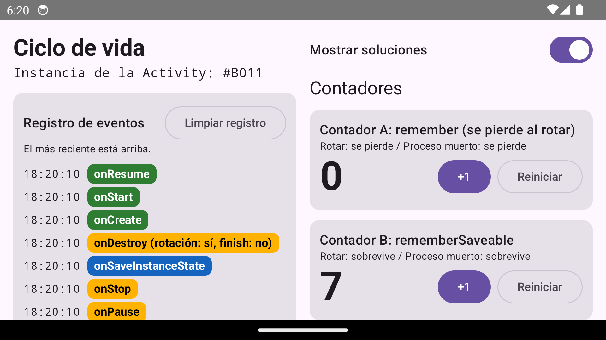

# Ciclo de vida: app de demostración

App Android de **una sola pantalla** para mostrar en vivo, en un emulador:

1. **Qué callbacks del ciclo de vida** se disparan al abrir la app, pulsar Inicio, volver desde Recientes, rotar el teléfono y pulsar Atrás.
2. **Qué pasa con el estado al rotar**: un contador con `remember` **se pierde**. Uno con `rememberSaveable` y otro guardado en un `ViewModel` **sobreviven**.
3. *(Bonus)* **Qué pasa cuando el sistema mata el proceso**: solo sobrevive `rememberSaveable`.

Está hecha con Kotlin, Jetpack Compose y Material 3. Tiene una sola Activity y no pide permisos ni usa internet.



---

## Qué hay en la pantalla

| Zona | Qué muestra |
|---|---|
| **Cabecera** | Título y `Instancia de la Activity: #XXXX`. Es un identificador de la Activity actual que **cambia al rotar** porque se crea una Activity nueva. |
| **Registro de eventos** | Los últimos 40 callbacks, con el más reciente arriba y su hora. 🟩 Verde: subida (`onCreate`, `onStart`, `onResume`, `onRestart`). 🟨 Ámbar: bajada (`onPause`, `onStop`, `onDestroy`). 🟦 Azul: `onSaveInstanceState`. Tiene un botón **Limpiar registro**. |
| **Mostrar soluciones** | Interruptor que muestra u oculta los contadores B y C. Su valor también sobrevive a la rotación. |
| **Contadores** | **A** con `remember` (siempre visible), **B** con `rememberSaveable` y **C** con `ViewModel`. |
| **Cerrar la app (finish)** | Llama a `finish()` para mostrar un cierre explícito. |

Cada evento se imprime también en **Logcat** con el tag `CicloVida`.

---

## Requisitos

| Herramienta | Versión usada |
|---|---|
| Windows 10/11 con **Git Bash** (o macOS / Linux) | — |
| **JDK** | 17 |
| **Android SDK** | platform-tools, `platforms;android-35`, `build-tools;36.0.0`, emulator |
| **Imagen del emulador** | `system-images;android-34;google_apis;x86_64` (o `arm64-v8a` en CPU ARM) |
| **git** | cualquiera reciente |

No hace falta instalar Gradle porque el proyecto trae su *wrapper* (`gradlew`). `scripts/setup-env.sh` comprueba todo lo demás e instala lo que falte.

Versiones del proyecto (en [gradle/libs.versions.toml](gradle/libs.versions.toml)): AGP 9.5.1, Kotlin 2.4.21, Gradle 9.9.0, Compose BOM 2026.06.01, lifecycle 2.10.0. `compileSdk` y `targetSdk` son 35, y `minSdk` es 26.

> **Importante (Windows):** compila el proyecto en una **ruta corta, sin espacios y fuera de OneDrive**, por ejemplo `C:\dev\ciclovida-demo`. OneDrive puede bloquear archivos de `build/` mientras Gradle los escribe.

---

## Cómo correr la demo (orden exacto)

Abre **Git Bash** en la carpeta del proyecto (`ciclovida-demo/`):

```bash
# 1. Verificar e instalar lo necesario y crear el AVD "ciclovida_api34" (solo la primera vez)
./scripts/setup-env.sh

# 2. Encender el emulador y esperar a que arranque
./scripts/start-emulator.sh

# 3. Compilar, instalar y abrir la app
./scripts/instalar-app.sh

# 4. (Opcional, en OTRA terminal) ver los eventos en Logcat
./scripts/logcat.sh
```

Durante la demo:

```bash
./scripts/rotar.sh          # alterna vertical <-> horizontal
./scripts/rotar.sh auto     # vuelve a la rotación automática al terminar
./scripts/matar-proceso.sh  # bonus: mata el proceso de la app
```

> Si `./scripts/x.sh` responde "Permission denied", ejecútalo como `bash scripts/x.sh`.

---

## Guion de la demo

Antes de empezar, pulsa **Limpiar registro** para partir de cero.

### Ciclo de vida, en 5 pasos

| # | Acción | Resultado esperado en el registro (en orden) |
|---|---|---|
| 1 | **Abrir la app** | `onCreate` → `onStart` → `onResume` |
| 2 | **Pulsar Inicio** (círculo) | `onPause` → `onStop` *(y después `onSaveInstanceState` en azul)* |
| 3 | **Volver desde Recientes** (cuadrado o deslizar hacia arriba) | `onRestart` → `onStart` → `onResume`. **No hay `onCreate`**: es la misma Activity, y el identificador de instancia no cambia. |
| 4 | **Rotar** (`./scripts/rotar.sh` o los botones del emulador) | `onPause` → `onStop` → *`onSaveInstanceState`* → `onDestroy (rotación: sí, finish: no)` → `onCreate` → `onStart` → `onResume`. **Cambia el identificador de instancia.** |
| 5 | **Pulsar Atrás** | `onPause` → `onStop` → `onDestroy (rotación: no, finish: sí)` |

Qué decir en cada paso:

- **Paso 2:** la app sigue en memoria, solo deja de verse.
- **Paso 3:** vuelve la *misma* Activity, por eso hay `onRestart` y no `onCreate`.
- **Paso 4:** rotar es un *cambio de configuración*. Android **destruye la Activity y crea otra**. El registro no se borra porque vive en un objeto del proceso, no en la Activity.
- **Paso 5:** con Atrás la Activity termina (`finish: sí`). El botón **Cerrar la app (finish)** produce lo mismo.
- `onSaveInstanceState` (azul) aparece **después de `onStop`** en Android 9 o superior. Ahí el sistema guarda el estado que luego recupera `rememberSaveable`.

### Demo de los contadores

1. Enciende **Mostrar soluciones**.
2. Toca **+1 siete veces** en A, en B y en C (los tres en **7**).
3. **Rota** el teléfono.

| Contador | Después de rotar | Por qué |
|---|---|---|
| **A**: `remember` | **0** | El valor vivía en la composición de la Activity destruida. |
| **B**: `rememberSaveable` | **7** | Se guardó en `onSaveInstanceState` y se recuperó en la Activity nueva. |
| **C**: `ViewModel` | **7** | El `ViewModel` no se destruye al rotar: la Activity nueva recibe el mismo. |

En horizontal la pantalla se divide en dos columnas. Si no ves algún contador, desplázate.

### Bonus: el sistema mata el proceso

Android puede matar una app en segundo plano para liberar memoria. Para simularlo:

1. Con **Mostrar soluciones** encendido, pon A, B y C en **7**.
2. Ejecuta `./scripts/matar-proceso.sh`. Envía la app a segundo plano y mata su proceso.
3. En el emulador, abre **Recientes** y toca la tarjeta de *Ciclo de vida*.

| Contador | Después de matar el proceso |
|---|---|
| **A**: `remember` | **0** |
| **B**: `rememberSaveable` | **7**: el estado guardado sobrevive al proceso |
| **C**: `ViewModel` | **0**: el ViewModel vivía en la memoria del proceso |

También verás que el interruptor sigue encendido (usa `rememberSaveable`) y que el registro empieza de cero con `onCreate`, `onStart` y `onResume`, porque `LogCicloVida` vivía en el proceso que se mató.

**Conclusión:** un `ViewModel` protege el estado de la rotación, pero **no** de la muerte del proceso. Para eso hay que guardar el estado con `rememberSaveable` o con `SavedStateHandle` dentro del ViewModel.

---

## ¿Por qué Android 14 (API 34)?

La guía oficial de [cambios de configuración](https://developer.android.com/guide/topics/resources/runtime-changes) dice: *"Starting with Android 17 (API level 37), the system no longer restarts activities by default for several configuration changes that typically don't require full UI recreation."*

Esos cambios son los del teclado, la navegación, la pantalla táctil, el modo de color y el modo escritorio. **La rotación no está en esa lista**, así que la Activity se sigue recreando al rotar. Aun así, la demo usa un emulador con **Android 14 (API 34)** para mostrar el comportamiento clásico sin diferencias entre versiones.

---

## Si algo sale mal

| # | Problema | Solución |
|---|---|---|
| 1 | **El emulador no arranca** o `start-emulator.sh` se queda esperando | Cierra cualquier emulador abierto y vuelve a ejecutar el script. Revisa el registro que indica el script (`emulador-ciclovida_api34.log`). En Windows comprueba que la virtualización esté activa en la BIOS y que esté instalado *Windows Hypervisor Platform*. |
| 2 | **`adb: command not found`** o "No se encontró adb" | Los scripts buscan el SDK en `ANDROID_HOME` o en `C:\Android\Sdk`. Si está en otra ruta, ejecuta `export ANDROID_HOME="/c/ruta/al/Sdk"` antes de los scripts, o vuelve a correr `./scripts/setup-env.sh`. |
| 3 | **La pantalla no rota** con los botones del emulador | La rotación automática quedó desactivada (por ejemplo, tras usar `rotar.sh`). Ejecuta `./scripts/rotar.sh auto`, o activa "Girar automáticamente" en los ajustes rápidos del emulador. |
| 4 | **`rotar.sh` no hace nada** | Comprueba que la app esté en primer plano: el escritorio del Pixel no rota. |
| 5 | **"El emulador 'ciclovida_api34' no está encendido"** | Ejecuta `./scripts/start-emulator.sh`. Si usas otro emulador o un teléfono real, instala el APK a mano con `adb install -r app/build/outputs/apk/debug/app-debug.apk`. |
| 6 | **La app no aparece instalada** o `INSTALL_FAILED_...` | Vuelve a ejecutar `./scripts/instalar-app.sh`. Si persiste, desinstálala con `adb uninstall com.demo.ciclovida` y repite. |
| 7 | **Gradle sin red** (`Could not resolve...`, timeouts) | La primera compilación descarga dependencias. Comprueba la conexión, el proxy del sistema o la VPN. Si `repo.maven.apache.org` responde **403**, el proyecto ya incluye el espejo de Google en `settings.gradle.kts`. Con las dependencias ya descargadas, `./gradlew assembleDebug --offline` funciona sin red. |
| 8 | **Error de Java/JDK** (`Unsupported class file major version`, "JAVA_HOME is invalid") | Usa **JDK 17**. Comprueba con `java -version`. Si `JAVA_HOME` apunta a otra versión, corrígelo o bórralo para que se use el `java` del PATH. |
| 9 | **Errores raros de archivos bloqueados** al compilar en OneDrive | Copia el proyecto a una ruta corta como `C:\dev\ciclovida-demo` y compila allí. |
| 10 | **`matar-proceso.sh` dice que el proceso sigue vivo** | La app tiene que estar abierta antes de ejecutarlo. El script pulsa Inicio y espera 2 s. Vuelve a intentarlo. |
| 11 | **Al reabrir tras matar el proceso, B también está en 0** | Reabre la app desde **Recientes**, no desde el icono tras deslizarla fuera de Recientes. Si la quitas de Recientes, se borra el estado guardado. |
| 12 | **`logcat.sh` no muestra nada** | Se ven solo los eventos nuevos con el tag `CicloVida`. Abre o rota la app con `logcat.sh` corriendo en otra terminal. |
| 13 | **Al pulsar Atrás no aparece `onDestroy`** | En Android 14 (API 34) sí aparece. Algunas versiones o fabricantes solo envían la app a segundo plano al pulsar Atrás en la pantalla principal. Usa el botón **Cerrar la app (finish)** para mostrar el cierre. |

---

## Estructura

```
ciclovida-demo/
├── app/src/main/java/com/demo/ciclovida/
│   ├── MainActivity.kt        # los callbacks del ciclo de vida y setContent
│   ├── LogCicloVida.kt        # el registro de eventos (objeto de nivel de proceso)
│   ├── ContadorViewModel.kt   # el ViewModel del contador C
│   └── PantallaCicloVida.kt   # la interfaz en Compose
├── scripts/                   # setup-env, start-emulator, instalar-app, rotar, logcat, matar-proceso
├── docs/EXPLICACION_CODIGO.md # explicación del código archivo por archivo
└── gradle/libs.versions.toml  # versiones de las librerías
```

La explicación detallada del código está en [docs/EXPLICACION_CODIGO.md](docs/EXPLICACION_CODIGO.md).
